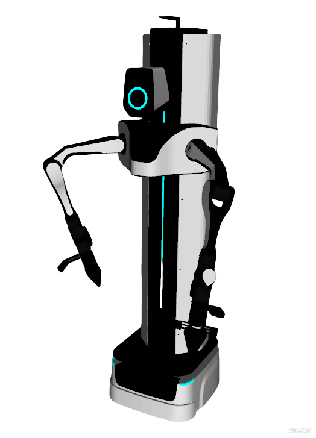

# Airbot MMK2 Description

URDF / xacro and control configs for the Discover Robotics **Airbot MMK2** wheeled dual-arm platform. The original models can be found at [DISCOVERSE](https://github.com/TATP-233/DISCOVERSE).

- Chassis: differential drive (wheels locked by default)
- Body: prismatic **slide** (lift, `slide_joint`) + head yaw / pitch
- Arms: Airbot Play (6-DOF) × 2 (from `airbot_play_description`)
- Grippers: built-in parallel jaws; `*_gripper_joint` + `adaptive_gripper_controller`

## 1. Build

```bash
cd ~/ros2_ws
colcon build --packages-up-to airbot_mmk2_description --symlink-install
```

## 2. Visualize the robot

```bash
source ~/ros2_ws/install/setup.bash
ros2 launch robot_common_launch manipulator.launch.py robot:=airbot_mmk2
```



## 3. Control (mock)

Uses `xacro/ros2_control/robot.xacro` with `hardware:=mock_components` (also `gz` / `isaac`).

### 3.1 Full body (全身 WBC)

Slide + dual Airbot Play + head in one `ocs2_wbc_controller` (chassis fixed).
Body follow is off (`bodyTrackingEE` false): the body is lift-only (`slide_joint`), locked by default via `customJointLock`. Head follow is on (`headMode HEAD_GAZE`: `head_camera` on `head_pitch_link` looks at the hands' midpoint, like W2/Zerith); `homeJointReference` softly pulls non-locked joints toward controller `home_1`.
OCS2 model: `config/ocs2/fixed_base_tcp.info`.

```bash
source ~/ros2_ws/install/setup.bash
ros2 launch ocs2_arm_controller full_body.launch.py robot:=airbot_mmk2
ros2 launch ocs2_arm_controller full_body.launch.py robot:=airbot_mmk2 hardware:=isaac
```

### 3.2 Dual-arm OCS2 demo

Airbot Play dual arms via `ocs2_arm_controller`. Slide / head / grippers are separate controllers.

```bash
source ~/ros2_ws/install/setup.bash
ros2 launch ocs2_arm_controller demo.launch.py robot:=airbot_mmk2
ros2 launch ocs2_arm_controller demo.launch.py robot:=airbot_mmk2 hardware:=gz
ros2 launch ocs2_arm_controller demo.launch.py robot:=airbot_mmk2 hardware:=isaac
```

### 3.3 Split body (arms + slide + head)

```bash
source ~/ros2_ws/install/setup.bash
ros2 launch ocs2_arm_controller split_body.launch.py robot:=airbot_mmk2
```

- Arms: `/ocs2_arm_controller/...`
- Slide: `/body_joint_controller/...` (`slide_joint` [m]; **positive = down**, range −0.04…0.87)
- Head: `/head_joint_controller/...`
- Grippers: `/left_hand_controller`, `/right_hand_controller` (`adaptive_gripper_controller` on `left_gripper_joint` / `right_gripper_joint`)

### 3.4 Official OCS2 Mobile Manipulator demo

Uses `config/ocs2/mobile_demo.info` (wheel-based mobile model, slide as an arm DOF).

```bash
source ~/ros2_ws/install/setup.bash
ros2 launch robot_common_launch manipulator_ocs2.launch.py robot_name:=airbot_mmk2 task_file:=mobile_demo
```

### 3.5 End-effector / gripper notes

- Joint names: `left_gripper_joint` / `right_gripper_joint` (`*_gripper_joint1` follows)
- TCP frames: `left_gripper_center` / `right_gripper_center`

### 3.6 Chassis joints (drive wheels)

Same convention as FiveAges W2 / Ai2 Bot2 / Quanta X1 / Zerith H1:

- Default **`chassis_joints_movable:=false`**: `lft_wheel_joint` / `rgt_wheel_joint` are **`fixed`** (viz, planning, and control URDFs) and **not** in `ros2_control`.
- Set `chassis_joints_movable:=true` for diff-drive navigation (wheel velocity interfaces + `diff_drive_controller`).

## 4. Navigation

* Gazebo Simulation
  ```bash
  source ~/ros2_ws/install/setup.bash
  ros2 launch robot_common_launch diff_drive.launch.py robot:=airbot_mmk2 world:=warehouse chassis_joints_movable:=true
  ```
* SLAM Toolbox
  ```bash
  source ~/ros2_ws/install/setup.bash
  ros2 launch robot_common_launch navigation_slam.launch.py
  ```

## 5. Layout

| Path | Role |
|------|------|
| `xacro/robot.xacro` | Visualization kinematics (`chassis_joints_movable`) |
| `xacro/ros2_control/robot.xacro` | Hardware plugins + joint interfaces |
| `config/ros2_control/ros2_controllers.yaml` | Controller manager |
| `config/rviz/fullbody.rviz` / `splitbody.rviz` | RViz (Fixed Frame `world` / `base_link`), auto-picked by `full_body` / `split_body` launch |
| `config/ocs2/task.info` | Dual-arm OCS2 model (demo / split arms) |
| `config/ocs2/fixed_base_tcp.info` | Full-body WBC (slide locked + arms + head; no body TRACKING); Pinocchio 4 order slide\|head\|L\|R |
| `config/ocs2/target_manager.yaml` | Marker / VR frames (`base_link`, `head_pitch_link`) |
| `config/ocs2/mobile_demo.info` | Official OCS2 mobile-manipulator demo model |
