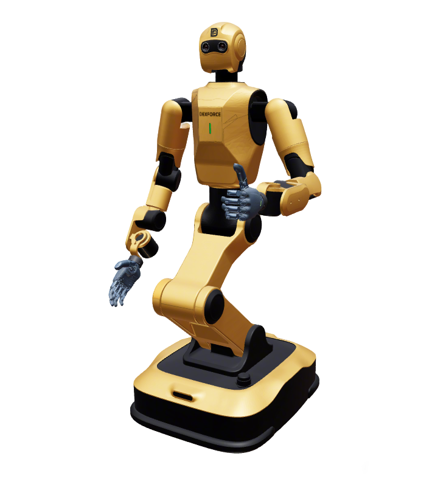
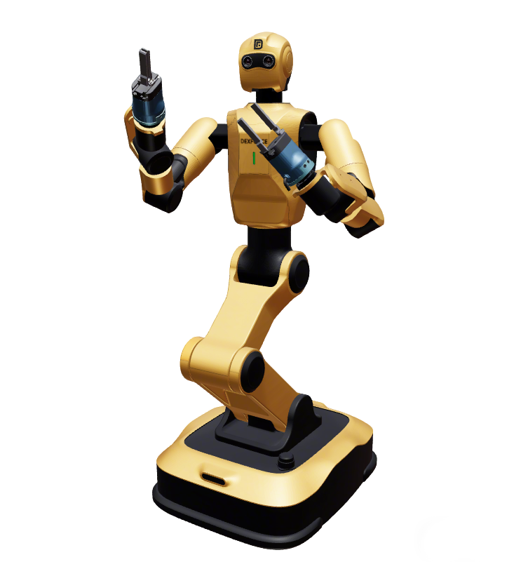

# Dexforce W1 Humanoid

This package contains the description files for DexForce W1 humanoid. The origin models could be found at [EmbodiChain](https://github.com/DexForce/EmbodiChain).

## 产品型号说明

- **拟人机械臂 ANTHROPOMORPHIC**
  - 模拟人体手臂关节结构设计
  - 适用于需要人机交互的场景
    
- **工业机械臂 INDUSTRIAL**
  - 专业工业级设计
  - 适用于工业自动化生产场景
    

## 1. Build

```bash
cd ~/ros2_ws
colcon build --packages-up-to dexforce_w1_description --symlink-install
```

## 2. Visualize the robot

To visualize and check the configuration of the robot in rviz, simply launch:

```bash
source ~/ros2_ws/install/setup.bash
ros2 launch robot_common_launch humanoid.launch.py robot:=dexforce_w1
```

```bash
source ~/ros2_ws/install/setup.bash
ros2 launch robot_common_launch humanoid.launch.py robot:=dexforce_w1 type:=pro
```

```bash
source ~/ros2_ws/install/setup.bash
ros2 launch robot_common_launch humanoid.launch.py robot:=dexforce_w1 type:=pro_pgc140
```

```bash
source ~/ros2_ws/install/setup.bash
ros2 launch robot_common_launch humanoid.launch.py robot:=dexforce_w1 type:=revo1
```

## 3. Control (mock)

Uses `xacro/ros2_control/robot.xacro` with `hardware:=mock_components` (also `gz` / `isaac`).
`type:=` selects the arm / end effector variant (`ANTHROPOMORPHIC` default, `revo1`, `pro`, `pro_pgc140`).

### 3.1 Full body (全身 WBC)

Body (4 folding / waist joints) + head (2) + dual 7-DOF arms in one `ocs2_wbc_controller` (chassis fixed).
Head follow is on by default (`headMode HEAD_GAZE`: `head_camera` on `neck2` looks at the hands' midpoint, like W2/Zerith); `homeJointReference` softly pulls joints toward controller `home_1`.
OCS2 model: `config/ocs2/fixed_base_tcp.info`.

```bash
source ~/ros2_ws/install/setup.bash
ros2 launch ocs2_arm_controller full_body.launch.py robot:=dexforce_w1
ros2 launch ocs2_arm_controller full_body.launch.py robot:=dexforce_w1 type:=pro
ros2 launch ocs2_arm_controller full_body.launch.py robot:=dexforce_w1 type:=pro_pgc140
ros2 launch ocs2_arm_controller full_body.launch.py robot:=dexforce_w1 type:=revo1
ros2 launch ocs2_arm_controller full_body.launch.py robot:=dexforce_w1 hardware:=isaac
```

### 3.2 Dual-arm OCS2 demo

Arms via `ocs2_arm_controller` (planning URDF `topology:=dual`, rooted at `waist`). Body / head / grippers are separate controllers.

```bash
source ~/ros2_ws/install/setup.bash
ros2 launch ocs2_arm_controller demo.launch.py robot:=dexforce_w1
ros2 launch ocs2_arm_controller demo.launch.py robot:=dexforce_w1 type:=pro
ros2 launch ocs2_arm_controller demo.launch.py robot:=dexforce_w1 type:=pro_pgc140
ros2 launch ocs2_arm_controller demo.launch.py robot:=dexforce_w1 type:=revo1
```

### 3.3 Split body (arms + body + head)

```bash
source ~/ros2_ws/install/setup.bash
ros2 launch ocs2_arm_controller split_body.launch.py robot:=dexforce_w1
```

- Arms: `/ocs2_arm_controller/...`
- Body: `/body_joint_controller/...` (`body_joint1..4`)
- Head: `/head_joint_controller/...`
- Grippers (`pro_pgc140`): `/left_gripper_controller`, `/right_gripper_controller`
- Hands (`revo1`): `/left_hand_controller`, `/right_hand_controller`

### 3.4 End-effector notes

- OCS2 end-effector frames are `left_eef` / `right_eef` for every `type` (child of `left_tcp` / `right_tcp`; for `pro_pgc140` the gripper's own eef).
- Joint names: `left_gripper_joint` / `right_gripper_joint` (+ `*_finger2_joint`) for PGC 140-50; BrainCo Revo1 joints `left_hand_*` / `right_hand_*`.

### 3.5 Chassis joints (drive wheels)

Same convention as FiveAges W2 / Ai2 Bot2 / Quanta X1 / Zerith H1:

- Default **`chassis_joints_movable:=false`**: `WHEEL_LEFT` / `WHEEL_RIGHT` are **`fixed`**.
- Set `chassis_joints_movable:=true` only when you need movable (continuous) wheel DOFs.
- **Not** in `ros2_control` for the mock arm / WBC stack.

## 4. Layout

| Path | Role |
|------|------|
| `xacro/robot.xacro` | Visualization kinematics (`topology:=dual` = arms-only planning tree) |
| `xacro/ros2_control/robot.xacro` | Hardware plugins + joint interfaces |
| `config/ros2_control/common.yaml` | Shared controller config (all variants) |
| `config/ros2_control/ros2_controllers.yaml` / `pro.yaml` | Home poses for default (anthropomorphic / revo1) and industrial (`type:=pro*`) |
| `config/rviz/fullbody.rviz` / `splitbody.rviz` | RViz (Fixed Frame `world` / `base_link`), auto-picked by `full_body` / `split_body` launch |
| `config/rviz/demo_ocs2.rviz` | RViz for `demo.launch.py` |
| `config/ocs2/task.info` | Dual-arm OCS2 model (demo / split arms) |
| `config/ocs2/fixed_base_tcp.info` | Full-body WBC (body + head + arms); Pinocchio 4 order body\|head\|L\|R, `headInputStart 4` |
| `config/ocs2/target_manager.yaml` | Marker / VR frames (`base_link`, `neck2`) |
