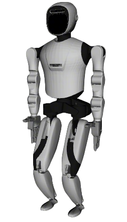

# RobotEra Xbot-L Description

This package contains the description files for RobotEra Xbot-L humanoid. The origin models could be found at [humanoid_gym](https://github.com/roboterax/humanoid-gym). Both wrists reuse the shared [`xhand1_description`](../../../common/dexhands/xhand1_description) (XHand1).

## 1. Build
```bash
cd ~/ros2_ws
colcon build --packages-up-to robotera_xbotl_description --symlink-install
```

## 2. Visualize the robot
### 2.1 Full Robot
```bash
source ~/ros2_ws/install/setup.bash
ros2 launch robot_common_launch visualize.launch.py robot:=robotera_xbotl
```



### 2.2 Component
* Base
  ```bash
  source ~/ros2_ws/install/setup.bash
  ros2 launch robot_common_launch component.launch.py robot:=robotera_xbotl type:=base
  ```
* Left Arm
  ```bash
  source ~/ros2_ws/install/setup.bash
  ros2 launch robot_common_launch component.launch.py robot:=robotera_xbotl type:=left
  ```
* Right Arm
  ```bash
  source ~/ros2_ws/install/setup.bash
  ros2 launch robot_common_launch component.launch.py robot:=robotera_xbotl type:=right
  ```
* Left Hand
  ```bash
  source ~/ros2_ws/install/setup.bash
  ros2 launch robot_common_launch component.launch.py robot:=robotera_xbotl type:=left_hand
  ```
* Right Hand
  ```bash
  source ~/ros2_ws/install/setup.bash
  ros2 launch robot_common_launch component.launch.py robot:=robotera_xbotl type:=right_hand
  ```
* Left Leg
  ```bash
  source ~/ros2_ws/install/setup.bash
  ros2 launch robot_common_launch component.launch.py robot:=robotera_xbotl type:=left_leg
  ```
* Right Leg
  ```bash
  source ~/ros2_ws/install/setup.bash
  ros2 launch robot_common_launch component.launch.py robot:=robotera_xbotl type:=right_leg
  ```
