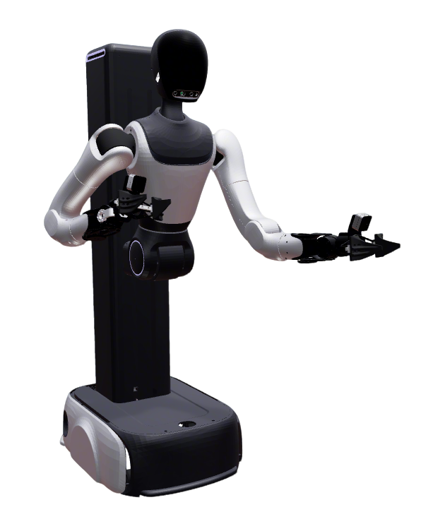

# Zerith H1 Description

URDF / xacro and control configs for the **Zerith H1** wheeled dual-arm platform.

- Chassis: differential drive (wheels locked by default); full-body WBC plans virtual SE(2) (`vx` / `omega`) on `base_footprint`
- Body: prismatic lift (`body_joint1`) + pitch (`body_joint2`) + yaw (`body_joint3`)
- Head: yaw / pitch (`head_joint1` / `head_joint2`)
- Arms: 7-DOF × 2
- End effectors: built-in parallel jaws by default (`type` empty / `gripper`); `type:=none` is bare wrists (Isaac import); `type:=revo1` / `type:=revo2` mounts BrainCo hands (Revo1 at the gripper pose; Revo2 uses the BrainCo flange at 0.066 m)
- Wrist camera: `camera` / `xacro_camera` is `d405` (stand + RealSense) or `none`. Empty defaults to `d405` with the gripper, `none` otherwise.

Upstream models: [Zerith_Model](https://github.com/inFpZero/Zerith_Model).

## 1. Build

```bash
cd ~/ros2_ws
colcon build --packages-up-to zerith_h1_description --symlink-install
```

## 2. Visualize

### 2.1 Full robot

```bash
source ~/ros2_ws/install/setup.bash
ros2 launch robot_common_launch humanoid.launch.py robot:=zerith_h1
ros2 launch robot_common_launch humanoid.launch.py robot:=zerith_h1 type:=none
ros2 launch robot_common_launch humanoid.launch.py robot:=zerith_h1 type:=revo1
ros2 launch robot_common_launch humanoid.launch.py robot:=zerith_h1 type:=revo2
ros2 launch robot_common_launch humanoid.launch.py robot:=zerith_h1 xacro_camera:=none
ros2 launch robot_common_launch humanoid.launch.py robot:=zerith_h1 type:=none xacro_camera:=d405
```



导入 Isaac 资产时去掉 `sensor_models` 视觉（关节和空 link 保留）：

```bash
ros2 launch robot_common_launch humanoid.launch.py robot:=zerith_h1 type:=none xacro_isaac:=true
```

### 2.2 Components

```bash
source ~/ros2_ws/install/setup.bash
ros2 launch robot_common_launch component.launch.py robot:=zerith_h1 type:=base
ros2 launch robot_common_launch component.launch.py robot:=zerith_h1 type:=arms
ros2 launch robot_common_launch component.launch.py robot:=zerith_h1 type:=chassis
ros2 launch robot_common_launch component.launch.py robot:=zerith_h1 type:=body
```

## 3. Control (mock)

Uses `xacro/ros2_control/robot.xacro` with `hardware:=mock_components` (also `gz` / `isaac`).

### 3.1 Full body (全身 WBC)

Virtual differential chassis + body + dual 7-DOF + head in one `ocs2_wbc_controller`.
OCS2 model: `config/ocs2/mobile_base_tcp.info` (`manipulatorModelType 1`).
Physical drive wheels / casters stay locked; chassis is planned as `vx` / `omega` and published on `/cmd_vel` when `world → base_footprint` TF exists and the base is unlocked.

```bash
source ~/ros2_ws/install/setup.bash
ros2 launch ocs2_arm_controller full_body.launch.py robot:=zerith_h1
ros2 launch ocs2_arm_controller full_body.launch.py robot:=zerith_h1 hardware:=isaac
ros2 launch ocs2_arm_controller full_body.launch.py robot:=zerith_h1 type:=revo1
ros2 launch ocs2_arm_controller full_body.launch.py robot:=zerith_h1 type:=revo2
```

Initial modes: body `HM_DUAL_RELATIVE_MOBILE_BASE`, head `HEAD_GAZE`
(`head_joint1`/`head_joint2` keep `head_camera` looking at the midpoint of both hands; `headInputStart 5`,
`headFrame neck_pitch_link`, `headMidpointGaze.cameraFrame head_camera`).
HOME joint reference (`homeJointReference`, default on, no excluded joints) softly pulls joints toward `home_1`;
toggle at runtime with `mode_command` `HOME_JOINT_ON` / `HOME_JOINT_OFF`.

To switch back to **fixed-base** WBC (`config/ocs2/fixed_base_tcp.info`, mode `HM_DUAL_CUSTOM_LOCK_FIXED_BASE`), patch via `robot.local.yaml` / control.patch:

```yaml
control:
  patch:
    ocs2_wbc_controller:
      ros__parameters:
        info_file_name: fixed_base_tcp
        fsm_default_humanoid_mode: HM_DUAL_CUSTOM_LOCK_FIXED_BASE
```

### 3.2 Dual-arm OCS2 demo

Arms via `ocs2_arm_controller`. Body / head / grippers are separate controllers.

```bash
source ~/ros2_ws/install/setup.bash
ros2 launch ocs2_arm_controller demo.launch.py robot:=zerith_h1
ros2 launch ocs2_arm_controller demo.launch.py robot:=zerith_h1 hardware:=isaac
```

### 3.3 Split body (arms + body + head)

```bash
source ~/ros2_ws/install/setup.bash
ros2 launch ocs2_arm_controller split_body.launch.py robot:=zerith_h1
```

- Arms: `/ocs2_arm_controller/...`
- Body: `/body_joint_controller/...` (`body_joint1` lift [m], single-joint waist lifting)
- Head: `/head_joint_controller/...`
- End effectors: `/left_gripper_controller`, `/right_gripper_controller` (default gripper); `/left_hand_controller`, `/right_hand_controller` (`type:=revo1` / `revo2`); none for `type:=none`

### 3.4 End-effector / gripper notes

- Default gripper joints: `left_gripper_joint` / `right_gripper_joint` (mimic `*_jaw_right_finger_joint` follows on the opposite axis). `0` is closed, positive opens (`adaptive_gripper_controller`: `initial_value` 0 sits on the lower limit).
- Revo1 / Revo2 joints: `left_hand_*` / `right_hand_*` (`basic_joint_controller` via EEF registry)
- `type:=none`: no gripper/hand meshes or joints; `eef` coincides with `tcp`
- Wrist camera (`xacro_camera:=d405` / `none`): D405 stand on `tcp` (`left_camera_support` / `right_camera_support`), optical frame `left_jaw_camera_link` / `right_jaw_camera_link`. Default gripper includes D405; `isaac:=true` hides the RealSense mesh and keeps the stand.
- Chassis lidar: Livox Mid360 `lidar_link` on `base_link` at `xyz="0.305327 0 0.016247"`. `isaac:=true` hides the mesh and keeps the frame.
- Flange: `left_tcp` / `right_tcp` (0.046 m from `wrist_pitch_link`); OCS2: `left_eef` / `right_eef`
- Revo1 mount: on `tcp` (same pose as the gripper base)
- Revo2 mount: flange on `tcp` at `xyz="0.0024 0 0"` so `hand_base` is 0.066 m from the wrist (flange_joint adds 0.0176 m)

### 3.5 Chassis joints (drive wheels)

Same convention as FiveAges W2 / Ai2 Bot2 / Quanta X1 / Galaxea:

- Default **`chassis_joints_movable:=false`**: drive wheels and casters are **`fixed`**.
- Full-body WBC plans a virtual differential SE(2) (`mobile_base_tcp`); it does **not** unlock wheel joints.
- Set `chassis_joints_movable:=true` only when you need movable wheel DOFs (e.g. component `type:=chassis`).
- **Not** in `ros2_control` for the mock arm / WBC stack.

```bash
ros2 launch robot_common_launch component.launch.py robot:=zerith_h1 type:=chassis
```

### 3.6 Collision

Default `collider:=simple` (launch already passes `collider`). The chest and waist are vertical cylinders (radii 0.085 m and 0.070 m); the lift carriage stays a box. The chassis deck is a box, and the rear mast is a tighter box inside the housing (`0.15 x 0.155 x 0.90` m). Arm cylinders follow each link toward the next joint; shoulder pitch (`link1`) has no simple collider because it sits on the torso. `collider:=convex` restores the visual GLBs — do not enable OCS2 `selfCollision` with that.

Full-body `selfCollision` (`fixed_base_tcp.info` and `mobile_base_tcp.info`, `activate true`, `minimumDistance 0.01`) pairs `body_yaw_link` with each arm's `shoulder_yaw` / `elbow` / `wrist_roll` / `wrist_pitch`. Split-arm `task.info` stays off. Head, gripper, and chassis meshes are not in those pairs.

## 4. Layout

| Path | Role |
|------|------|
| `xacro/robot.xacro` | Visualization kinematics (`chassis_joints_movable`, `isaac`, `type`, `camera`, `collider`) |
| `xacro/ros2_control/robot.xacro` | Hardware plugins + joint interfaces |
| `config/ros2_control/ros2_controllers.yaml` | Controller manager |
| `config/ocs2/task.info` | Dual-arm OCS2 model (demo / split arms) |
| `config/ocs2/mobile_base_tcp.info` | Default full-body WBC (virtual diff SE(2) + body + arms + head); Pinocchio 4 order body\|head\|L\|R, `headInputStart 5` |
| `config/ocs2/fixed_base_tcp.info` | Fixed-base WBC fallback; same joint order, `headInputStart 3` |
| `config/ocs2/target_manager.yaml` | Marker / VR frames (`base_footprint`; head `head_link_name` / `reference_link` = `neck_pitch_link`) |
| `config/rviz/fullbody.rviz` / `splitbody.rviz` | RViz (Fixed Frame `world` / `base_footprint`), auto-picked by `full_body` / `split_body` launch |
