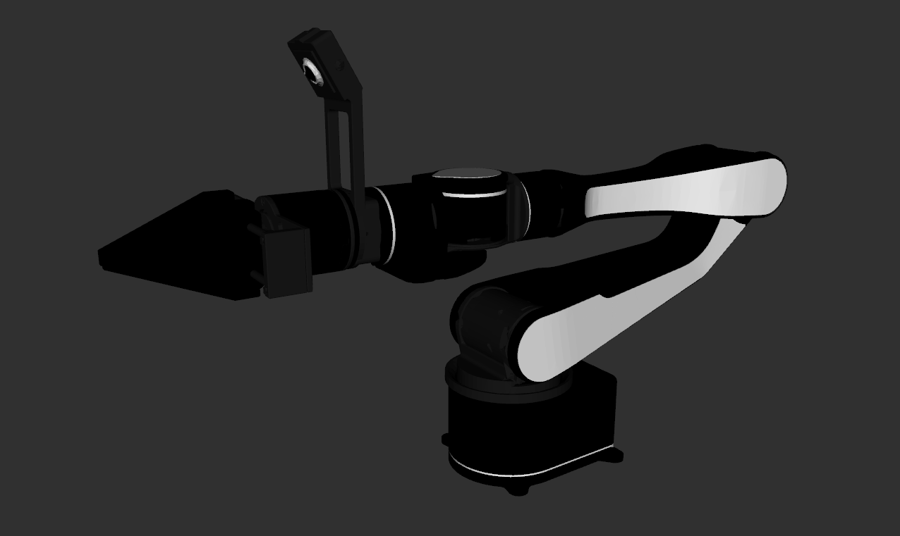

# Airbot Play Description

This package contains the description files for Discover Robotics's Airbot Play manipulator. The origin models could be cound at [DISCOVERSE](https://github.com/TATP-233/DISCOVERSE).

## 1. Build
```bash
cd ~/ros2_ws
colcon build --packages-up-to airbot_play_description --symlink-install
```

## 2. Visualize the robot

```bash
source ~/ros2_ws/install/setup.bash
ros2 launch robot_common_launch manipulator.launch.py robot:=airbot_play
ros2 launch robot_common_launch manipulator.launch.py robot:=airbot_play type:=xhand1
```

Default end effector is the built-in parallel gripper. `type:=xhand1` mounts XHand1 on `link6` (offset 0.014 m).



## 3. OCS2 Demo

### 3.1 Official OCS2 Mobile Manipulator Demo

```bash
source ~/ros2_ws/install/setup.bash
ros2 launch robot_common_launch manipulator_ocs2.launch.py robot_name:=airbot_play
```

### 3.2 OCS2 Arm Controller Demo

* Mock Component
  ```bash
  source ~/ros2_ws/install/setup.bash
  ros2 launch ocs2_arm_controller demo.launch.py robot:=airbot_play
  ```

* Gazebo Simulation
  ```bash
  source ~/ros2_ws/install/setup.bash
  ros2 launch ocs2_arm_controller demo.launch.py robot:=airbot_play hardware:=gz
  ```

* Isaac Sim
  ```bash
  source ~/ros2_ws/install/setup.bash
  ros2 launch ocs2_arm_controller demo.launch.py robot:=airbot_play hardware:=isaac
  ```
* Discoverse Simulation (Mujoco)
  ```bash
  source ~/ros2_ws/install/setup.bash
  ros2 launch ocs2_arm_controller demo.launch.py robot:=airbot_play hardware:=discoverse
  ```