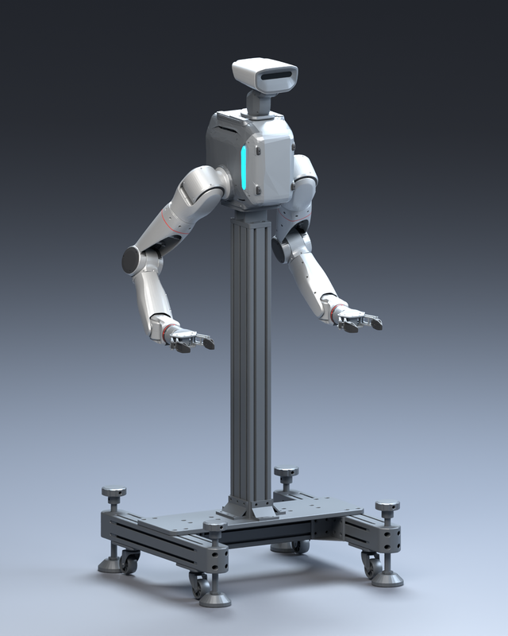

# LimX Dynamics DACH_TRON2B Description

逐际动力 DACH_TRON2B 固定基座双臂描述包，包含底座、躯干、头部和双侧可动夹爪。整机模型由 `xacro/robot.xacro` 生成，OCS2 Demo 控制双臂，头部和夹爪使用独立控制器。



在 Ubuntu 24.04 容器中构建。若当前终端尚未加载 ROS 2 和公司的控制器工作区，先加载 Jazzy 和 `fa-deploy-ws` 的环境。

```bash
cd ~/open-deploy-ws
colcon build --packages-select dach_tron2b_description --symlink-install
source install/setup.bash
```

## 1. 可视化与启动

| 场景 | 启动命令 |
| --- | --- |
| RViz 整机查看 | `ros2 launch robot_common_launch manipulator.launch.py robot:=dach_tron2b` |
| OCS2 Mock 控制 | `ros2 launch ocs2_arm_controller demo.launch.py robot:=dach_tron2b` |
| OCS2 + Isaac Sim | `ros2 launch ocs2_arm_controller demo.launch.py robot:=dach_tron2b hardware:=isaac` |

Isaac 先用 FaSim 根目录的 `./run.sh` 启动，选择 PhysX。打开 TRON2B 的 `env/empty.usda`（联动演示）或 `env/grasp_table.usda`（桌面抓取）并点 **Play**，再启动 OCS2。RViz 的 Fixed Frame 使用 `base_link`。

单独检查部件时，使用 `component.xacro`。支持 `type:=body|head|arm|gripper`，手臂和夹爪可用 `side:=L|R` 选择侧别。下面以右臂为例。

```bash
xacro "$(ros2 pkg prefix --share dach_tron2b_description)/xacro/component.xacro" type:=arm side:=R
```

## 2. 双臂、夹爪与头部

- **双臂**由 [OCS2 任务配置](config/ocs2/task.info) 控制。规划关节顺序为左臂 7 个、右臂 7 个，末端坐标系为 `L_ee_link` 和 `R_ee_link`。启动后进入 `HOLD`，点击 `HOME` 可让双臂回到预设姿态。
- **夹爪**由左右控制器独立驱动。可用 RViz 夹爪面板，也可向 `/left_gripper_controller/target_percent` 或 `/right_gripper_controller/target_percent` 发送 `std_msgs/msg/Float64`。归一化位置 `0` 为闭合，`1` 为全开，对应主驱动角度 `-0.09522` 到 `0.77302 rad`。
- **头部**可用 `ros2 run controller_manager spawner dach_tron2b_head_controller` 单独激活。话题 `/dach_tron2b_head_controller/commands` 接收按 yaw、pitch 排列的两个位置值，单位为弧度。D455 在 RViz 复用 `sensor_models` 的显示网格，光学坐标系与 FaSim 的共享 D455 对齐。

## 3. 模型与配置

| 文件 | 用途 |
| --- | --- |
| [`xacro/robot.xacro`](xacro/robot.xacro) | 组装整机，显示及网格碰撞统一使用 GLB。FaSim 联动直接加载现有 USD |
| [`xacro/components/`](xacro/components/) | 躯干、头部、手臂和夹爪。左右臂和夹爪复用部件网格，各侧安装位姿在 Xacro 中定义 |
| [`xacro/ros2_control/`](xacro/ros2_control/) | 硬件插件和关节接口 |
| [`config/ros2_control/ros2_controllers.yaml`](config/ros2_control/ros2_controllers.yaml) | 控制器配置和双臂 HOME 关节角度 |

OCS2 自碰撞使用躯干及夹爪底座盒体和手臂圆柱，配置了 12 对连杆，最小距离参数为 10 mm。FaSim 中的彩色 USD 和接触场景由 `robot_usds` 仓库维护。

## 4. TRON2 家族与部件复用

厂家仓库包含 TRON2A 的 DACH 版本，以及 TRON2B 的 DA、DACH、DASF、DASF2、SF、SFYG、WF 和 WFYG 版本。当前描述包对应固定基座的 DACH_TRON2B。各版本的底座、肢体构型和末端配置可在文末的厂家仓库中查阅。

| 上游版本 | 网格复用情况 |
| --- | --- |
| DA_TRON2B | 23 组 STL 网格均能在上游 DACH_TRON2B 中找到完全相同的文件 |
| DASF_TRON2B / DASF2_TRON2B | 两者共享 32 组网格几何，其中部分也用于 DACH_TRON2B |
| SF / SFYG、WF / WFYG | SF 与 SFYG 共用 SF 的 11 组网格几何。WF 与 WFYG 共用 WF 的 11 组网格几何 |
| DACH_TRON2A | 与 DACH_TRON2B 有 34 组完全相同的 STL，底座和部分臂部、腕部网格需要单独核对 |

以上是对厂家 STL 的比对结果。当前包已在 [`meshes/`](meshes/) 中按 `body`、`head`、`arm` 和 `gripper` 整理，左右臂和两侧夹爪共用部件网格，侧别、镜像和安装位姿由 [组件 Xacro](xacro/components/) 指定。

后续接入同家族机型时，相同几何只保留一份，各机型引用共享网格。经旋转或镜像后可复用的部件，先核对安装方向和接触面，再在 Xacro 中配置变换。只有几何确有差异时才新增网格，例如不同的外壳、支架、安装孔或夹持面。关节轴、限位、惯量和 TCP 仍按各机型定义。显示网格与碰撞网格分别核对。

## 5. 来源与验证

上游版权署名为 © 2024–2026 LimX Dynamics Inc.，许可证为 [Apache-2.0](LICENSE)。

模型来自逐际动力 [TRON2 官方描述仓库](https://github.com/limxdynamics/tron2-robot-description/tree/d81d2a83a3c718bc68deca4e8804fdc984dc34f7) 的 `tron2b/DACH_TRON2B`。关节和惯量以 `robot_grasper.urdf` 为基准，两个 TCP 的偏移取自 `robot_zeromass_graser.urdf`。彩色网格参考了厂家产品图。

已验证 26 个 Xacro 变体可以展开，网格路径均可解析。对比厂家模型，44 个原有关节和 45 个共有连杆的惯性数据通过检查。
