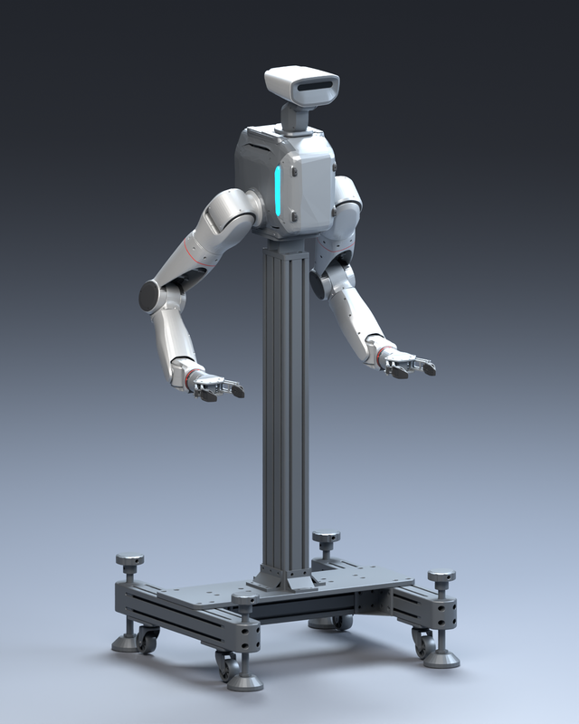

# LimX Dynamics TRON2B_DACH Description

逐际动力 TRON2B_DACH 固定基座双臂描述包，包含底座、躯干、头部和双侧可动夹爪。整机模型由 `xacro/robot.xacro` 生成，OCS2 Demo 控制双臂，头部和夹爪使用独立控制器。



## Build

在已加载 ROS 2 Jazzy 的工作空间中构建。以下以 `~/ros2_ws` 为例。

```bash
cd ~/ros2_ws
colcon build --packages-up-to tron2b_dach_description --symlink-install
source install/setup.bash
```

## Visualize

在 RViz 中查看整机模型。

```bash
ros2 launch robot_common_launch manipulator.launch.py robot:=tron2b_dach
```

### Component

用 [`component.xacro`](xacro/component.xacro) 单独展开躯干、头部、手臂或夹爪。通过 `type:=body|head|arm|gripper` 选择部件，手臂和夹爪用 `side:=L|R` 指定侧别。以下以右臂为例。

```bash
xacro "$(ros2 pkg prefix --share tron2b_dach_description)/xacro/component.xacro" type:=arm side:=R
```

## Control / OCS2

使用 Demo 前，先加载包含 `ocs2_arm_controller` 和 `adaptive_gripper_controller` 的工作空间环境，再加载当前描述包工作空间。

### Mock

```bash
ros2 launch ocs2_arm_controller demo.launch.py robot:=tron2b_dach
```

控制器启动后进入 `HOLD`。RViz 的 Fixed Frame 使用 `base_link`。

### Isaac Sim

在 FaSim-Isaac 根目录运行 `./run.sh`，选择 PhysX，并打开 `robots/manipulators/LimX/TRON2/TRON2B_DACH/env/empty.usda`。桌面抓取场景位于同目录的 `grasp_table.usda`。在 Isaac Sim 中点 **Play**，然后启动 ROS 2 控制器。

```bash
ros2 launch ocs2_arm_controller demo.launch.py robot:=tron2b_dach hardware:=isaac
```

### 双臂、夹爪与头部

- **双臂**由 [OCS2 任务配置](config/ocs2/task.info) 控制。规划关节顺序为左臂 7 个、右臂 7 个，末端坐标系为 `L_ee_link` 和 `R_ee_link`。启动后进入 `HOLD`，点击 `HOME` 可让双臂回到预设姿态。
- **夹爪**由左右控制器独立驱动。可用 RViz 夹爪面板，也可向 `/left_gripper_controller/target_percent` 或 `/right_gripper_controller/target_percent` 发送 `std_msgs/msg/Float64`。归一化位置 `0` 为闭合，`1` 为全开，对应主驱动角度 `-0.09522` 到 `0.77302 rad`。
- **头部**可用 `ros2 run controller_manager spawner tron2b_dach_head_controller` 单独激活。话题 `/tron2b_dach_head_controller/commands` 接收按 yaw、pitch 排列的两个位置值，单位为弧度。D455 在 RViz 复用 `sensor_models` 的显示网格，光学坐标系与 FaSim 的共享 D455 对齐。

## Model and Configuration

| 文件 | 用途 |
| --- | --- |
| [`xacro/robot.xacro`](xacro/robot.xacro) | 组装底座、躯干、头部、双臂、夹爪和传感器 |
| [`xacro/components/`](xacro/components/) | 躯干、头部、手臂和夹爪。左右臂和夹爪复用部件网格，各侧安装位姿在 Xacro 中定义 |
| [`xacro/ros2_control/`](xacro/ros2_control/) | 硬件插件和关节接口 |
| [`config/ros2_control/ros2_controllers.yaml`](config/ros2_control/ros2_controllers.yaml) | 控制器配置和双臂 HOME 关节角度 |

- **显示几何**使用 GLB。
- **ROS 碰撞几何**主要使用简化盒体和圆柱，落地底座使用 GLB。OCS2 从规划 URDF 读取碰撞体，并检查 [`task.info`](config/ocs2/task.info) 配置的 18 对连杆，最小距离参数为 10 mm。
- **Isaac Sim 物理碰撞**由 `robot_usds` 中的 USD 物理层定义。

## TRON2 家族与部件复用

当前描述包对应固定基座 TRON2B_DACH，网格在 [`meshes/`](meshes/) 中按 `body`、`base`、`head`、`arm` 和 `gripper` 组织。

- **双臂和夹爪**共用部件网格，侧别、镜像和安装位姿由 [组件 Xacro](xacro/components/) 定义。大臂哑黑挡板随共用的 `proximal_yaw.glb` 装配。
- **支架**的落地框架、脚轮总成和调平脚总成分别保存于 [`meshes/base/`](meshes/base/)。四角各引用一份共享的脚轮和调平脚网格，装配位姿集中在 [`base.xacro`](xacro/components/base.xacro)。
- **躯干主体**的显示网格 `meshes/body/base.glb` 取自 DACH_TRON2A 的 `base_Link.STL`，装配到 TRON2B_DACH 整机。
- **相机**复用 `sensor_models` 网格，躯干用 D435，头部用 D455。FaSim 的共享 D455 相机保留独立光学位姿。

每个可复用部件保存为一个 GLB。外壳、灯条、面板、轮子和调平脚等组件在 GLB 内保留独立对象。颜色按组件分配，发光红环按关节接缝的面分配。

### 上游版本对照

厂家仓库还包含 TRON2A 的 DACH 版本，以及 TRON2B 的 DA、DASF、DASF2、SF、SFYG、WF 和 WFYG 版本。下表为厂家 STL 的比对结果。接入其他机型时，相同几何可共用，安装变换、关节限位、惯量和 TCP 按各机型核对。

| 上游版本 | 网格复用情况 |
| --- | --- |
| DA_TRON2B | 23 组 STL 网格均能在上游 DACH_TRON2B 中找到完全相同的文件 |
| DASF_TRON2B / DASF2_TRON2B | 两者共享 32 组网格几何，其中部分也用于上游 DACH_TRON2B |
| SF / SFYG、WF / WFYG | SF 与 SFYG 共用 SF 的 11 组网格几何。WF 与 WFYG 共用 WF 的 11 组网格几何 |
| DACH_TRON2A | 与上游 DACH_TRON2B 有 34 组完全相同的 STL，底座和部分臂部、腕部网格需要单独核对 |

## 来源与验证

上游版权署名为 © 2024–2026 LimX Dynamics Inc.，许可证为 [Apache-2.0](LICENSE)。

模型来自逐际动力 [TRON2 官方描述仓库](https://github.com/limxdynamics/tron2-robot-description/tree/d81d2a83a3c718bc68deca4e8804fdc984dc34f7) 的 `tron2b/DACH_TRON2B`。关节和惯量以 `robot_grasper.urdf` 为基准，两个 TCP 的偏移取自 `robot_zeromass_graser.urdf`。彩色网格参考了厂家产品图。

已验证 26 个 Xacro 变体可以展开，网格路径均可解析。对比厂家模型，44 个原有关节和 45 个共有连杆的惯性数据通过检查。
